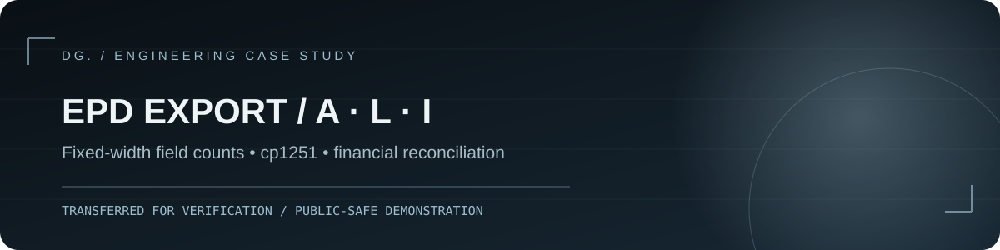

# Выгрузка ЕПД: файлы A / L / I из 1С

Разрабатывал выгрузку данных из 1С для единого платёжного документа: файлы абонентов, начислений и сообщений. Настраивал соответствия услуг, проверял структуру и исправлял расхождения перед контрольной загрузкой.

**Что можно посмотреть:** Публичный пример показывает формирование и проверку структуры трёх файлов на вымышленных данных. Финансовые расчёты исходной базы и полная спецификация оператора здесь не воспроизводятся.

**Тип:** профессиональный кейс 1С · **Статус:** реализация и локальные проверки завершены, комплект передан на контрольную проверку/загрузку; окончательная приёмка внешней системой отдельно не заявляется.

> В репозитории нет исходного корпоративного BSL, производственной обработки `.epf`, ТЗ заказчика или выгруженных файлов. Здесь опубликованы **самостоятельный учебный валидатор структуры** и искусственные примеры, созданные для демонстрации подхода.

## Задача

Создать внешнюю обработку, которая за выбранный расчётный месяц формирует три типа текстовых файлов по согласованному формату обмена:

| Файл | Назначение | Структура в кейсе |
|---|---|---|
| `AMMYY.txt` | Абоненты и адресные данные | заголовок 6 / строка 20 полей |
| `LMMYY.txt` | Начисления, финансовые показатели | заголовок 6 / строка 14 полей |
| `IMMYY.txt` | Сообщения для печати | заголовок 6 / строка 3 поля |

Здесь `MMYY` — месяц и последние две цифры года; разделитель `=`, кодировка Windows-1251. Пустое значение сохраняет свою позицию: `foo==bar`. Числовые реквизиты и специфические коды подлежат **проверке по соглашению конкретного оператора** — публичный валидатор не воспроизводит закрытую схему целиком.

## Вклад в реализацию

- Отдельные команды выгрузки A/L/I и общий сценарий формирования файла на сервере с передачей результата пользователю.
- Запросы к справочникам и регистрам по периоду, получение сальдо, начислений, льгот, перерасчётов и оплат; итоговую финансовую сверку проводили отдельно.
- Таблица соответствий услуг с пользовательскими настройками без изменения конфигурации клиентских баз; группировка кодов услуг в согласованном формате.
- Нормализация адреса и текста, контроль полей, Windows-1251, фиксированный разделитель и пустые позиции.
- Разбор обнаруженных расхождений на тестовых выгрузках, повторное формирование файлов и передача на контрольную загрузку.

## Демонстрация

```bash
python -m demo.generate_samples
python -m demo.validate demo/samples/A0426.txt demo/samples/L0426.txt demo/samples/I0426.txt
python -m unittest discover -s tests -v
```

Примеры в [`demo/samples`](demo/samples/) содержат **вымышленные записи** и иллюстрируют только каркас формата, а не настоящие начисления. Генератор использует `Decimal` для конвертации демонстрационной суммы в копейки — без ошибок `float`.

### Что проверяет публичный валидатор

- имя файла A/L/I и корректный месяц;
- декодирование в `cp1251` без замены недопустимых байтов; автоматического определения исходной кодировки нет;
- 6 полей в заголовке, 20/14/3 в строках соответствующего типа;
- количество полей, включая пустые позиции; генератор отдельно удаляет встроенные `=` и переводы строк;
- согласованность имени периода между входящими файлами набора.

Набор может быть неполным: валидатор не требует присутствия всех трёх типов и не обнаруживает дубли типов. Декодирование в CP1251 само по себе не доказывает исходную кодировку файла.

Он **не** заявляет о полной бизнес-валидации реального ЕПД или корректности сумм базы 1С — для этого нужны исходный контракт и контрольные эталоны.

## Схема обработки


Дополнительно: [принятые решения](docs/decisions.md), [контрольные проверки](docs/verification.md), [публичная безопасность](PUBLICATION_CHECKLIST.md).

## Требования и структура

Нужен Python 3.10 или новее. Внешние пакеты не требуются: используется только стандартная библиотека. Команды запускайте из корня репозитория. Автопроверки GitHub Actions настроены на Python 3.12.

```text
README.md       — задача, вклад, статус и запуск
demo/           — независимая демонстрация
docs/           — архитектура и ограничения
assets/         — обложка кейса
tests/          — модульные тесты демо
.github/        — автоматические проверки
```

## Права на материалы

Лицензия на свободное использование не предоставлена. Условия повторного использования кода и материалов необходимо согласовать с правообладателем. Публикация кейса не предоставляет прав на продукты 1С, 1С-Битрикс или материалы третьих лиц.
